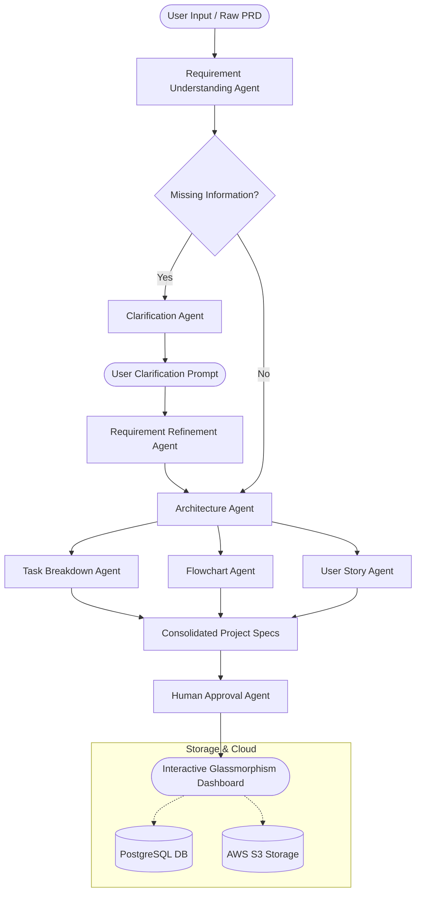

<div align="center">

# ⚡ RequiFlow

### *AI-Powered Requirements Engineering & Agile Lifecycle Orchestration Platform*

Transform raw ideas, messy PRDs, and business requirements into structured engineering specifications, dynamic Mermaid.js architecture diagrams, actionable sprint tasks, and developer-ready Agile user stories with testable acceptance criteria — powered by autonomous multi-agent AI orchestration.

[](https://react.dev/)
[](https://vitejs.dev/)
[](https://www.python.org/)
[](https://flask.palletsprojects.com/)
[](https://www.langchain.com/)
[](https://groq.com/)
[](https://www.postgresql.org/)
[](https://aws.amazon.com/s3/)
[](https://opensource.org/licenses/MIT)

</div>

---

## 📖 Table of Contents

- [Overview](#-overview)
- [Key Features](#-key-features)
- [Multi-Agent AI Pipeline](#-multi-agent-ai-pipeline)
- [System Architecture](#-system-architecture)
- [UI & Aesthetics](#-ui--aesthetics)
- [Tech Stack](#-tech-stack)
- [Project Structure](#-project-structure)
- [Prerequisites](#-prerequisites)
- [Installation & Setup](#-installation--setup)
- [Environment Variables](#-environment-variables)
- [Database Setup](#-database-setup)
- [Running the Application](#-running-the-application)
- [API Reference](#-api-reference)
- [Troubleshooting & FAQs](#-troubleshooting--faqs)
- [Roadmap](#-roadmap)
- [Contributing & License](#-contributing--license)

---

## 🌟 Overview

Requirements gathering and technical discovery are often plagued by ambiguity, misaligned stakeholders, and manual effort. **RequiFlow** solves this by acting as an autonomous virtual Product Team. 

When you enter raw requirements or upload a project document, RequiFlow orchestrates an ensemble of specialized AI agents running on **Groq's LPU inference engine** using **LLaMA 3.3 70B**. The pipeline validates clarity, questions missing constraints, synthesizes software architecture, plots live interactive diagrams, breaks down implementation tasks, and drafts fully qualified Agile user stories with Gherkin acceptance criteria.

---

## ✨ Key Features

- **🤖 Autonomous Multi-Agent Pipeline:** 8 specialized agents collaborate in an asynchronous LangChain pipeline to transform messy requirements into structured software artifacts.
- **💬 Interactive Clarification Loop:** When missing parameters, ambiguities, or technical risks are detected, the system pauses execution and poses targeted questions to the user before proceeding.
- **📊 Real-Time Mermaid Flowcharts:** Automatically converts architecture specifications into interactive, dark-themed Mermaid.js flowcharts and system topology diagrams.
- **📋 Developer-Ready Agile User Stories:** Generates standardized stories (`As a... I want to... So that...`) complete with:
  - Testable Given-When-Then Acceptance Criteria
  - Fibonacci Story Points estimation (1, 2, 3, 5, 8)
  - MoSCoW Prioritization (High, Medium, Low)
  - Functional Epics grouping
- **📄 Living Document Management:** Auto-generates and tracks Business Requirements Documents (BRD), Software Requirements Specifications (SRS), and User Story documents.
- **🎨 Glassmorphic Sci-Fi Dashboard:** Deep-space dark theme (`#050811`), ambient floating blur orbs, 60-second animated shifting grid, responsive cards, and micro-interactions.
- **☁️ Cloud Storage & Relational Persistence:** Direct integration with PostgreSQL for project state management and AWS S3 for secure file and PRD uploads.

---

## 🤖 Multi-Agent AI Pipeline

RequiFlow divides software analysis across distinct, collaborative agents:

| Agent | Module | Role & Responsibility |
|---|---|---|
| **Requirement Understanding Agent** | `requirement_understanding_agent.py` | Parses raw text into core goals, actors, functional features, technical constraints, and risks. |
| **Clarification Agent** | `clarification_agent.py` | Detects missing or vague information and compiles targeted clarification questions. |
| **Requirement Refinement Agent** | `requirement_refinement_agent.py` | Incorporates user answers back into the requirement set, resolving ambiguity. |
| **Architecture Agent** | `architecture_agent.py` | Designs the end-to-end technical system architecture, components, data flows, and tech stack. |
| **Task Breakdown Agent** | `task_breakdown_agent.py` | Decomposes architecture and features into actionable sprint tasks, epics, and dependencies. |
| **Flowchart Agent** | `flowchart_agent.py` | Compiles architecture and data pipelines into Mermaid.js graph syntax. |
| **User Story Agent** | `user_story_agent.py` | Generates full Agile user stories with acceptance criteria, priority, and story points. |
| **Human Approval Agent** | `human_approval_agent.py` | Human-in-the-loop review mechanism for governance before publishing or export. |

---

## 📐 System Architecture

The following diagram illustrates how user input traverses RequiFlow's multi-agent workflow:



---

## 🎨 UI & Aesthetics

RequiFlow features a carefully crafted glassmorphism design system built from the ground up:

- **Theme Palette:** Built on a deep-space obsidian base (`#050811`) and surface elevations (`#0c1120`, `rgba(15, 22, 42, 0.85)`).
- **Ambient Lighting:** Multi-phase floating radial blur orbs (`rgba(79, 140, 255, 0.10)` blue, `rgba(168, 85, 247, 0.08)` purple, `rgba(0, 212, 255, 0.06)` cyan).
- **Living Background:** Infinite 60s CSS grid animation shifting diagonally.
- **Typography:** Modern Google Fonts pairing: **Space Grotesk** for headings and telemetry values; **Inter** for clean UI readability.
- **Dynamic Views:**
  - **Dashboard:** High-level project metrics, active agents, recent activity, and system status.
  - **Projects:** Grid and list views with progress bars and status filters.
  - **Active Project Workspace:** Deep-dive tabs for Requirements, Architecture, Sprint Tasks, Diagrams, and User Stories.
  - **User Stories Backlog:** Filterable cards with inline tags, story points, and expandable acceptance criteria.
  - **AI Agents Monitor:** Live inspection of agent statuses and running pipelines.

---

## 🛠️ Tech Stack

### Frontend
- **Framework:** [React 18](https://react.dev/) + [Vite](https://vitejs.dev/)
- **Routing:** [React Router v7](https://reactrouter.com/)
- **Diagrams:** [Mermaid.js](https://mermaid.js.org/) (Custom dark theme integration)
- **Styling:** Custom CSS3 Design System with CSS variables, keyframe animations, and glassmorphism (No heavy utility framework dependencies)
- **Engine:** Dual architecture featuring an authoritative Vanilla JS state engine alongside modular React components

### Backend
- **Core Framework:** [Python 3.10+](https://www.python.org/) with [Flask 3.1](https://flask.palletsprojects.com/) & Asyncio
- **AI & LLM Orchestration:** [LangChain Core](https://www.langchain.com/), [ChatGroq](https://python.langchain.com/docs/integrations/chat/groq/), [Pydantic v2](https://docs.pydantic.dev/)
- **LLM Model:** LLaMA 3.3 70B Versatile via [Groq Cloud](https://groq.com/)
- **Auth Server:** Node.js / Express with JWT, bcrypt, and Nodemailer (SMTP verification)
- **Database:** [PostgreSQL](https://www.postgresql.org/) (psycopg2)
- **Object Storage:** [AWS S3](https://aws.amazon.com/s3/) via Boto3

---

## 📁 Project Structure

```text
requiflow/
├── backend/
│   ├── app.py                             # Main Flask REST & AI API server
│   ├── index.js                           # Express Auth & Verification server
│   ├── orchestrator.py                    # Multi-agent asynchronous pipeline
│   ├── requirement_understanding_agent.py # Goal & feature extraction agent
│   ├── clarification_agent.py             # Ambiguity & Q&A generation agent
│   ├── requirement_refinement_agent.py    # Clarification synthesis agent
│   ├── architecture_agent.py              # System & technical architecture agent
│   ├── task_breakdown_agent.py            # Sprint & developer task decomposition
│   ├── flowchart_agent.py                 # Dynamic Mermaid.js diagram agent
│   ├── user_story_agent.py                # Agile user story & acceptance criteria agent
│   ├── human_approval_agent.py            # HITL validation agent
│   ├── requirements.txt                   # Python backend dependencies
│   ├── .env.example                       # Environment template for backend
│   ├── routes/                            # Node authentication endpoints
│   ├── services/                          # AI service & fallback generators
│   └── models/                            # Database models
│
├── frontend/
│   ├── index.html                         # Entry HTML with Google Fonts & ambient orbs
│   ├── vite.config.js                     # Vite dev configuration (Port 3000)
│   ├── package.json                       # Frontend dependencies & scripts
│   ├── style.css                          # Global Glassmorphic design system
│   ├── app.js                             # Standalone Vanilla JS client engine
│   └── src/
│       ├── main.jsx                       # React DOM entry
│       ├── App.jsx                        # Root React component & state manager
│       ├── LandingPage.jsx                # Product landing page & onboarding
│       ├── components/                    # Reusable UI components
│       │   ├── Sidebar.jsx                # Navigation drawer
│       │   ├── Topbar.jsx                 # Search, notification counter & profile
│       │   ├── NewProjectModal.jsx        # Requirement submission modal
│       │   ├── NotificationsPanel.jsx     # Dropdown alert drawer
│       │   └── ToastContainer.jsx         # Animated toast feedback
│       └── views/                         # Application views
│           ├── DashboardView.jsx          # Executive dashboard
│           ├── ProjectsView.jsx           # All projects catalogue
│           ├── ActiveProjectView.jsx      # Requirements, diagrams & task workbench
│           ├── UserStoriesView.jsx        # Agile backlog view
│           ├── DocumentsView.jsx          # BRD/SRS documentation vault
│           ├── AiAgentsView.jsx           # Live agent telemetry view
│           └── SettingsView.jsx           # User & API preferences
│
├── package.json                           # Root scripts to run stack concurrently
├── detailed_report.md                     # Comprehensive architecture and UI report
└── README.md                              # Project documentation
```

---

## ⚡ Prerequisites

Before installing RequiFlow, ensure you have the following installed:

1. **Node.js** (v18.0.0 or higher) & **npm**
2. **Python** (v3.10 or higher) & **pip**
3. **PostgreSQL** (v14 or higher) running locally or hosted (e.g., Supabase / Neon / AWS RDS)
4. **Groq API Key** (Create a free key at [console.groq.com](https://console.groq.com/))
5. *(Optional)* **AWS S3 Bucket** and IAM credentials for file attachments

---

## 🚀 Installation & Setup

### 1. Clone the Repository

```bash
git clone https://github.com/your-username/requiflow.git
cd requiflow
```

### 2. Configure the Database

Start your PostgreSQL server and create the `requiflow` database and `projects` table:

```bash
# Connect to PostgreSQL
psql -U postgres

# Inside PSQL:
CREATE DATABASE requiflow;
\c requiflow;

CREATE TABLE projects (
    id SERIAL PRIMARY KEY,
    title VARCHAR(255) NOT NULL,
    raw_text TEXT,
    file_url TEXT,
    status VARCHAR(50) DEFAULT 'pending',
    created_at TIMESTAMP DEFAULT CURRENT_TIMESTAMP
);

\q
```

### 3. Backend Setup (Python & Flask)

```bash
cd backend

# Create and activate virtual environment
# On Linux/macOS:
python3 -m venv venv
source venv/bin/activate

# On Windows:
python -m venv venv
venv\Scripts\activate

# Install dependencies
pip install -r requirements.txt
```

### 4. Configure Backend Environment

Copy the `.env.example` file to `.env`:

```bash
cp .env.example .env
```

Open `backend/.env` and fill in your credentials:

```env
GROQ_API_KEY=gsk_your_groq_api_key_here
DB_NAME=requiflow
DB_USER=postgres
DB_PASSWORD=your_password
DB_HOST=localhost
DB_PORT=5432
PORT=5000

# Optional: AWS S3 Credentials
AWS_ACCESS_KEY_ID=your_aws_access_key
AWS_SECRET_ACCESS_KEY=your_aws_secret_key
AWS_REGION=us-east-1
AWS_BUCKET_NAME=your_bucket_name
```

### 5. Frontend Setup (React & Vite)

Navigate back to the frontend directory and install dependencies:

```bash
cd ../frontend
npm install
```

---

## 💻 Running the Application

You can run the frontend and backend together using root scripts, or run each server independently.

### Option A: Run Full-Stack Concurrently (Recommended)

From the project root directory:

```bash
# Install root orchestration dependencies
npm install

# Start both backend and frontend concurrently
npm run dev
```

> **Note for Linux / macOS Users:** If your root `package.json` specifies Windows python paths, you can start the services in separate terminals as shown below.

---

### Option B: Run Services in Separate Terminals

#### Terminal 1 — Python Flask Backend:
```bash
cd backend
# Activate your virtualenv (source venv/bin/activate or venv\Scripts\activate)
python app.py
```
*Backend runs on `http://localhost:5000`*

#### Terminal 2 — React / Vite Frontend:
```bash
cd frontend
npm run dev
```
*Frontend runs on `http://localhost:3000`*

---

## 📡 API Reference

### Flask AI & Orchestration Endpoints (`http://localhost:5000`)

| Endpoint | Method | Payload / Params | Description |
|---|---|---|---|
| `/api/health` | `GET` | None | Returns system health, UTC timestamp, and server uptime. |
| `/projects` | `GET` | None | Fetches all projects stored in PostgreSQL sorted by date. |
| `/projects/upload` | `POST` | `multipart/form-data` (`title`, `raw_text`, `file`) | Creates a new project and uploads documents to AWS S3. |
| `/projects/<id>` | `DELETE` | `id` in URL path | Deletes a project by ID from the database. |
| `/api/run-orchestrator` | `POST` | `{ "input_text": "..." }` or `{ "user_answers": {...} }` | Executes the autonomous multi-agent pipeline and returns refined requirements, architecture, tasks, and diagrams. |
| `/api/generate-user-stories`| `POST` | `{ "requirement": "..." }` or full project context | Generates structured user stories with acceptance criteria and story points. |

### Node.js Auth Endpoints (`http://localhost:5000/api/auth`)

| Endpoint | Method | Description |
|---|---|---|
| `/api/auth/register` | `POST` | Registers a new user and dispatches an email verification token. |
| `/api/auth/login` | `POST` | Validates credentials and returns a signed JWT. |
| `/api/auth/verify-email/:token` | `GET` | Verifies a newly registered user account. |

---

## ❓ Troubleshooting & FAQs

<details>
<summary><b>1. What happens if I don't provide a GROQ_API_KEY?</b></summary>
The backend includes defensive fallback logic. If <code>GROQ_API_KEY</code> is absent or rate-limited, the User Story and Analysis agents will fall back to an internal deterministic mock generator so you can test the UI workflows without interruptions.
</details>

<details>
<summary><b>2. Mermaid diagrams fail to render or show syntax errors.</b></summary>
LLMs occasionally inject invalid characters into Mermaid edge labels. RequiFlow's <code>ActiveProjectView.jsx</code> contains a built-in regex sanitization layer that automatically cleans special characters from arrow labels before rendering.
</details>

<details>
<summary><b>3. Why is Vite running on port 3000 instead of 5173?</b></summary>
The Vite configuration in <code>frontend/vite.config.js</code> has been preset to port 3000 with <code>open: true</code> for optimal developer ergonomics.
</details>

<details>
<summary><b>4. How do I switch between the React view and the Vanilla JS view?</b></summary>
The default dev server mounts the React application at <code>frontend/src/main.jsx</code>. The Vanilla JS engine is available in <code>frontend/app.js</code> and can be loaded directly through standard static servers.
</details>

---

## 🗺️ Roadmap

- [ ] **Two-Way Jira & Azure DevOps Integration:** Export generated epics, user stories, and acceptance criteria straight into your engineering board.
- [ ] **Automated Test Generation:** Synthesize Cypress, Playwright, and Jest test scenarios directly from acceptance criteria.
- [ ] **Multi-Model Provider Support:** Add toggleable provider options for Anthropic Claude 3.5 Sonnet, OpenAI GPT-4o, and local Ollama models.
- [ ] **Interactive PRD Export:** Download finalized specifications as branded PDFs, Markdown reports, or Notion pages.

---

## 🤝 Contributing

Contributions make the open-source community an inspiring place to learn, create, and build. Any contributions you make are **greatly appreciated**.

1. Fork the Project
2. Create your Feature Branch (`git checkout -b feature/AmazingFeature`)
3. Commit your Changes (`git commit -m 'Add some AmazingFeature'`)
4. Push to the Branch (`git push origin feature/AmazingFeature`)
5. Open a Pull Request

---

## 📄 License

Distributed under the **MIT License**. See `LICENSE` for more information.

<div align="center">
Made with ❤️ for Product Managers, Engineers, and Systems Architects.
</div>
